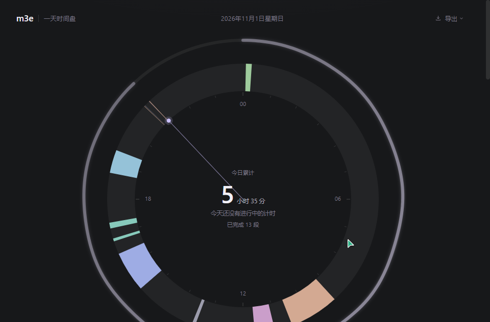

# m3e 一天时间盘

把一天 24 小时压成一圈的可视化计时工具：先给事件命名，再开始正计时或倒计时，所有记录都落在同一个环形时间盘上，并自动汇总成今日 / 本周 / 本月的统计与热力图。

界面全中文，视觉遵循 m3e：近黑底、深灰圆角卡、低饱和淡紫强调、细字重、几乎无边框，图标一律内联 SVG。



## 功能清单

- **先命名，再计时**：名称必填；历史名称按使用频次排序并带色点，点一下即可快速切换；同名跨刷新、跨天保持同一颜色。
- **正计时 / 倒计时**：倒计时固定为「设定时长」（预设 15 / 25 / 45 / 60 分钟，自定义 1 分钟–24 小时），到点自动结束并提醒；不存在「倒计时到某个钟点」模式。
- **24 小时环形时间盘**：0:00 在正上方、顺时针排布；跨零点的记录按天切成两段；暂停间隙不并入净时长；运行中的弧段会实时伸长并呼吸发光；有当前时间指针、悬停浮层、点击进入详情、盘心当日累计、外侧当天进度环与内侧倒计时剩余环。
- **计时引擎基于时间戳**：所有时长由分段 `[start, end]` 时间戳计算，不使用定时器累加；倒计时终点 = 首段开始时间 + 设定时长，休眠或刷新后仍准确。
- **暂停 / 继续 / 快速切换 / 手动补记**：暂停区间单独计数与展示；手动补记支持跨零点，时间盘两天各出现对应片段。
- **未结束计时的恢复选择**：刷新后若存在未结束计时，必须由用户选择「算到现在 / 算到推定结束点 / 结束于指定时间 / 继续计时」，绝不静默收口。
- **统计面板**：今日 / 本周 / 本月三张卡（净时长、峰值、累计、连续天数）+ 今日 24 格热力图 + 本月 GitHub 风格热力图；有效时长、总时长与碎片率有公式 tooltip。
- **记录详情与修改痕迹**：可改名称、起止时间、备注、中断标记；每次修改由服务端写入 revisions，详情里可查看改前 / 改后 / 时间；删除保留软删除痕迹。
- **导出**：JSON（全量，含修订与颜色注册表）与 CSV（UTF-8 BOM，Excel 打开中文不乱码）。

## 运行方式

要求 Node.js ≥ 20（本次在 `v24.15.0`、npm `11.12.1` 下验证），Windows PowerShell。

```powershell
npm install
npm run dev        # 默认 http://localhost:3000
```

若 3000 端口被其它项目占用，指定未占用端口：

```powershell
npx nuxt dev --port 3100
```

其他命令：

```powershell
npm run test       # Vitest，43 个纯函数用例
npm run typecheck  # nuxt typecheck
npm run build
npm run preview
```

## 数据存放位置与格式

数据保存在项目根目录的 `./.data/store.json`（自动创建，已被 `.gitignore` 忽略）。可用环境变量 `M3E_DATA_DIR` 指定其它目录：

```powershell
$env:M3E_DATA_DIR = "D:\m3e-data"
npm run dev
```

文件结构：

```json
{
  "schemaVersion": 1,
  "colorRegistry": { "深度工作": 7, "会议": 9 },
  "records": [
    {
      "id": "uuid",
      "name": "深度工作",
      "colorIndex": 7,
      "mode": "countup",
      "targetMs": null,
      "note": "",
      "interrupted": false,
      "segments": [{ "start": 1793523900000, "end": 1793529600000 }],
      "status": "ended",
      "createdAt": 1793523900000,
      "updatedAt": 1793529600000,
      "revisions": [],
      "deletedAt": null
    }
  ]
}
```

- `segments` 是计时的事实来源：暂停即收口当前段，继续则追加开放段（`end: null` 表示仍在进行）。
- 写入采用「临时文件 + rename」的原子写，并用模块级串行队列避免并发覆盖；JSON 损坏时会先备份为 `store.corrupt-<时间戳>.json`，再以空库启动并在界面提示。
- 删除记录为软删除（记录保留 `deletedAt` 与删除修订），导出里会标注「已删除」。

## 波浪进度条实现（mtrl）

圆形与线性波浪进度条统一使用 [mtrl](https://github.com/floor/mtrl) 0.10.8 的 `m-progress`（`shape="wavy"`），不自写 SVG/CSS 波浪动画，也不引入其它图表或动画库：

- **客户端注册**：`app/plugins/mtrl.client.ts`（必须 `.client` 后缀，mtrl 依赖 `document`），显式导入 `mtrl/styles/base` 与 `mtrl/elements/css` 后再调 `defineAll()`；`nuxt.config.ts` 把 `m-` 前缀登记为自定义元素，避免 Vue 告警。
- **主题映射**：`main.css` 用 `html:root` 把 `--mtrl-sys-color-*` 映射到项目 token（`--m3e-accent` / `--m3e-surface-*` 等），进度条颜色不硬编码，跟随主题；`tone` 只在组件根节点局部覆盖 `--mtrl-sys-color-primary`。
- **`WaveBar`（线性）**：`variant="linear" + shape="wavy"`，线宽 6（行内）/ 8（主进度）；宿主显式 `display:block; width:100%`，否则宽度会塌缩。
- **`WaveRing`（圆形）**：`variant="circular"`，`shape` 可选 `flat` / `wavy`。mtrl 圆形画布上限 240px，因此以 240px 绘制后用 `ResizeObserver` 读出容器宽度，按 `transform: scale(容器宽/240)` 等比放大到时间盘尺寸；设计线宽按 `size` 等比换算，视觉线宽与原方案一致。
- **主页双环用 `flat` 不用波浪**：时间盘外圈表示「今天已过的时间比例」，内圈表示「倒计时剩余比例」，两者都是平滑圆环，并在盘心用「外圈 · 今天已过 N%」「内圈 · 倒计时剩余 N%」两行小字直接标注用途与百分比，避免波浪让读盘变糊。
- **实际使用位置**：波浪线性进度用于计时面板的倒计时进度、统计面板的有效时长占比、记录列表的单条时长占比；时间盘外圈 / 内圈为常规圆环。
- mtrl 仅在客户端注册，SSR 首屏输出空的 `m-progress` 占位，升级后才绘制画布，不影响首屏渲染。

## 目录说明
```
app/
  assets/css/main.css        m3e 设计 token、基础样式与 mtrl 主题映射
  plugins/mtrl.client.ts     mtrl 客户端注册（仅波浪进度条使用）
  components/                自研基础控件、WaveBar/WaveRing（mtrl 包装）、时间盘、计时、统计、记录详情
  composables/               全局时钟、计时引擎、记录数据、导出、toast
  pages/index.vue            单页主视图编排
shared/
  types.ts                   TimeRecord / Segment / Revision 等类型
  utils/time.ts              跨天切分、净时长、跨度、倒计时终点、周范围等纯函数
  utils/color.ts             16 色注册表 + FNV-1a 哈希 + 线性探测
  utils/arc.ts               环形扇区几何
  utils/stats.ts             区间汇总、碎片率、热力档位、连续天数、月度网格
server/
  utils/store.ts             JSON 原子写、串行队列、修订与软删除
  api/                       data / records / export 接口
tests/                       Vitest 纯函数测试与 fixtures
docs/                        Prompt、参考图、截图
```

## 实现取舍

- **mtrl 的使用范围**：已安装 `mtrl@0.10.8`，但**只用于波浪进度条**（`m-progress` 的 `variant="linear|circular"` + `shape="wavy"`）；卡片、按钮、输入、分段控件、模态框、时间盘等其余界面仍为自研 m3e 控件，用 CSS 变量贴近「近黑底 + 深灰卡 + 低饱和淡紫」的观感。`sober` 未安装。
- 时间与统计逻辑全部放在 `shared/utils` 纯函数里，组件与模板只消费结果；测试直接覆盖这些函数。
- 颜色同时满足「同名同色」与「不同名不同色」：前 16 个名称直接占用调色板，超过 16 个后按轮次派生色相与明度，保证新名称不再复用已有色值。
- 服务端统一分配颜色并记录修订，避免客户端并发导致注册表分叉。
- SSR 安全：首屏渲染骨架，`onMounted` 后才读取 `Date.now()`、`window` 与 `AudioContext`，避免 hydration mismatch。

## 已知限制

- P1 项未实现：空格快捷键暂停 / 继续、每日目标设置、记录搜索。
- 按需求不做多页导航、历史日期浏览与日期切换；时间盘固定显示今天。
- 倒计时提示音需要用户此前在页面上点过按钮（浏览器对自动播放的限制）；页面在后台时提示条与标题闪烁仍会生效，但可能听不到声音。
- 数据只保存在本机，无账号与云同步；清理 `.data` 目录会清空记录。
- 自动化截图覆盖 1440 宽度主视图；窄屏布局按 1199px / 767px 断点单列排布，本次未逐档截图。
